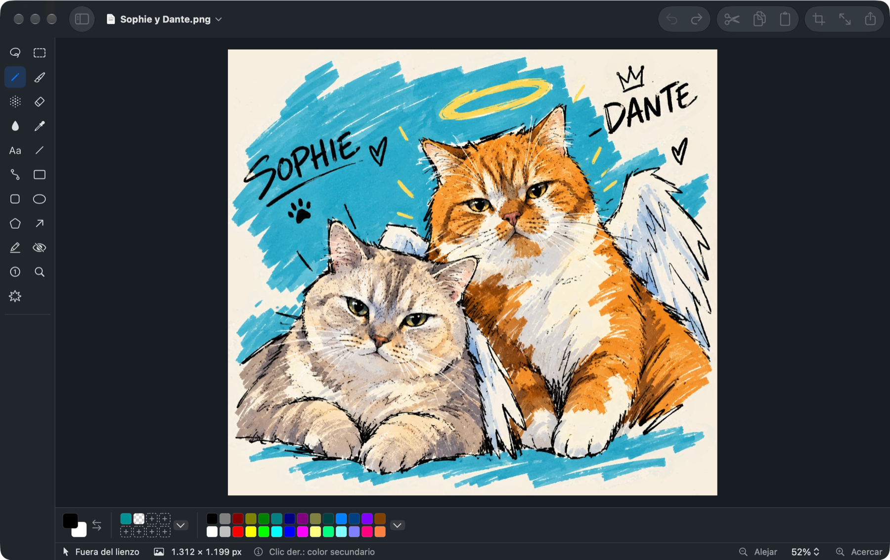

# StaiN

[](https://github.com/fbonnemaison/StaiN/actions/workflows/ci.yml)
[](LICENSE)

Editor de imágenes raster sencillo para macOS, inspirado en Microsoft Paint (antes Paintbrush) y MacPaint.
Escrito en Swift, open source (MIT). Autor: **App-Zilla**.



> Consulta la versión actual y los cambios en [CHANGELOG.md](CHANGELOG.md), y el plan en [TODO.md](TODO.md).
> Guía de uso: [wiki](https://github.com/fbonnemaison/StaiN/wiki).

## Descargar e instalar

1. Descarga `StaiN-X.Y.Z.dmg` de [Releases](https://github.com/fbonnemaison/StaiN/releases), ábrelo y arrastra
   **StaiN** a **Aplicaciones**.
2. **La primera vez**, macOS avisa de que no puede verificar la app: StaiN es gratuito y no está notarizado
   (la notarización exige un programa de pago de Apple). Pulsa **Hecho**, ve a **Ajustes del Sistema ›
   Privacidad y seguridad**, baja hasta **Seguridad** y pulsa **Abrir igualmente** junto al aviso de StaiN.
   Confirma con tu contraseña o Touch ID. Solo hace falta una vez.

   Alternativa desde el Terminal: `xattr -dr com.apple.quarantine /Applications/StaiN.app`

Funciona en Mac con Apple Silicon e Intel, con macOS 26 o superior.

## Requisitos

- macOS 26 o superior
- Xcode 27 o superior

## Estructura

```
StaiN/                 App macOS (SwiftUI + lienzo AppKit)
StaiNUITests/          Tests de interfaz (XCUITest)
Packages/StainKit/     Motor de dibujo, sin UI ni dependencias
docs/                  Captura del README, instrucciones del primer arranque y páginas de la wiki
project.yml            Definición del proyecto para XcodeGen
```

## Compilar

Abre `StaiN.xcodeproj` en Xcode y ejecuta el esquema **StaiN**, o desde la terminal:

```bash
xcodebuild -project StaiN.xcodeproj -scheme StaiN -destination 'platform=macOS' build
```

Tests del motor:

```bash
swift test --package-path Packages/StainKit
```

Si modificas `project.yml`, regenera el proyecto con [XcodeGen](https://github.com/yonaskolb/XcodeGen):

```bash
xcodegen generate
```

## Instalar desde el código

```bash
./scripts/install.sh
```

Compila en Release e instala (o sustituye) `/Applications/StaiN.app`.

## Empaquetar para distribuir

```bash
./scripts/package-dmg.sh
```

Crea en `dist/` el `StaiN-X.Y.Z.dmg` (app universal, acceso a Aplicaciones e instrucciones del primer arranque),
un `.zip` con la app y la suma SHA-256 de cada uno. Solo usa herramientas de macOS y no tiene costes.

## Versiones

StaiN usa [Versionado Semántico](https://semver.org/lang/es/) y anota los cambios en [CHANGELOG.md](CHANGELOG.md).
Para publicar una versión, apunta los cambios en `## [Sin publicar]` y ejecuta:

```bash
./scripts/bump-version.sh minor
```

(`major`, `minor`, `patch` o un número concreto). El script actualiza la versión y el número de compilación,
fecha la sección del CHANGELOG, hace commit y crea la etiqueta `vX.Y.Z`. No sube nada a GitHub.

## Scripts

- `scripts/format.sh` — formatea el código (`--lint` solo comprueba).
- `scripts/install.sh` — compila e instala en `/Applications`.
- `scripts/package-dmg.sh` — crea el `.dmg` y el `.zip` para distribuir en `dist/`.
- `scripts/publish-wiki.sh` — publica en la wiki de GitHub las páginas de `docs/wiki/`.
- `scripts/bump-version.sh` — sube la versión, actualiza el CHANGELOG y crea la etiqueta.
- `scripts/icon-from-image.swift` — regenera el icono a partir del diseño `Design/AppIcon-source.png`:
  `swift scripts/icon-from-image.swift Design/AppIcon-source.png StaiN/Resources/Assets.xcassets/AppIcon.appiconset`
- `scripts/update-strings.py` — regenera las traducciones al inglés a partir de los textos que extrae el compilador
  (las traducciones están en `scripts/translations_en.json`).
- Pruebas de rendimiento con imágenes de 8000 × 8000:

```bash
STAIN_PERF=1 swift test -c release --package-path Packages/StainKit --filter Performance
```

## Referencias

- [SSheldon/Paintbrush](https://github.com/SSheldon/Paintbrush): referencia funcional (GPL-3.0, no se reutiliza su código).
- [joshlin2201/itspaint](https://github.com/joshlin2201/itspaint): referencia de arquitectura (MIT).

## Licencia

[MIT](LICENSE) © 2026 App-Zilla. Consulta [AUTHORS.md](AUTHORS.md) y [THIRD-PARTY-NOTICES.md](THIRD-PARTY-NOTICES.md).
