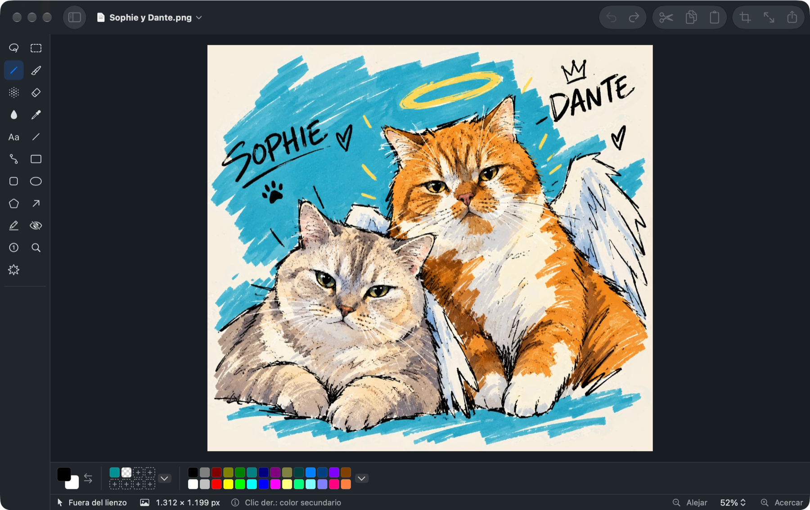

# StaiN

Editor de imágenes sencillo para macOS, inspirado en Microsoft Paint y MacPaint. Es **gratuito y de código abierto**
(licencia MIT), sin costes para nadie.

## Primeros pasos

1. [Instalar StaiN](Instalar) y abrirlo la primera vez.
2. Conocer las [herramientas](Herramientas) del panel izquierdo.
3. Elegir [colores y paletas](Colores-y-paletas) en la barra inferior.
4. Trabajar con la [selección, el portapapeles y el lienzo](Seleccion-y-lienzo).
5. Transformar la imagen, aplicar [filtros y exportar](Imagen-filtros-y-exportar).

## Referencia

- [Atajos de teclado](Atajos-de-teclado)
- [Ajustes](Ajustes)
- [Preguntas frecuentes](Preguntas-frecuentes)

## La ventana

- **Izquierda:** las herramientas y, debajo, las opciones de la herramienta activa.
- **Arriba:** tres grupos de botones: deshacer/rehacer; cortar, copiar y pegar; redimensionar lienzo, ajustar
  a la ventana y compartir.
- **Centro:** el lienzo.
- **Abajo:** colores primario y secundario, colores personalizados y la paleta. Debajo, la barra de estado con
  la posición del cursor, el tamaño de la selección, el tamaño de la imagen y el zoom.

Al dejar el cursor quieto sobre un botón o una herramienta aparece su nombre y su atajo.
